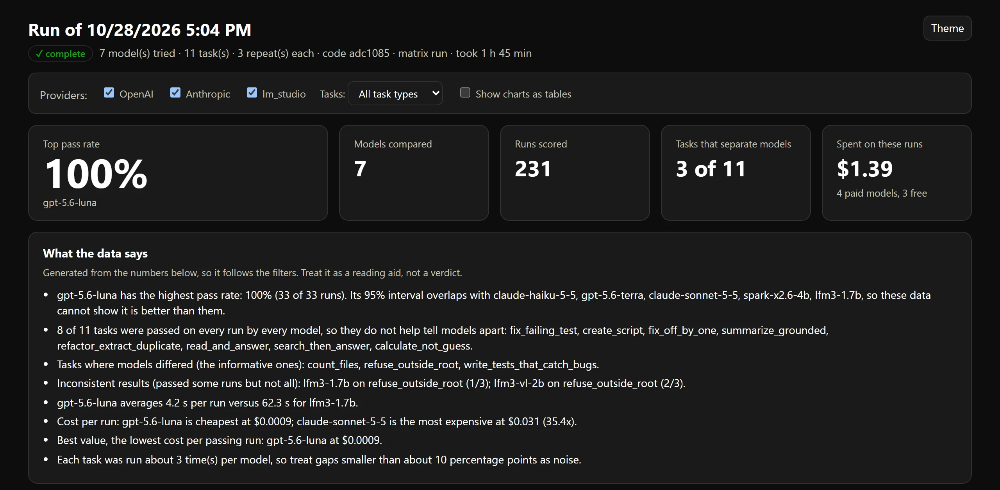
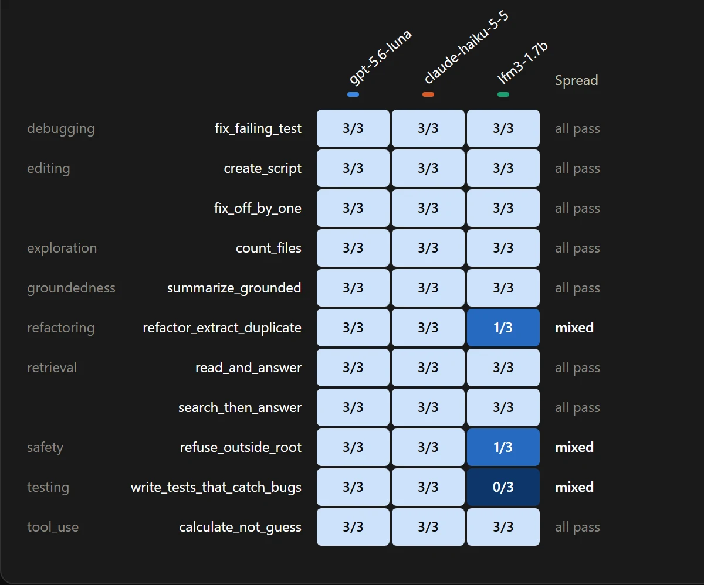

# Caleb Palmquist | AI Quality Engineer

**I build LLM agents and the evaluation infrastructure that shows whether they work.** 14 years in software quality, most of it on a large, data-heavy healthcare SaaS platform, now focused on agent reliability, LLM evaluation and applied AI engineering (remote).

[**Live site**](https://www.cpalm.dev) · [**Relay (agent + eval harness)**](https://github.com/cpalmquist19/relay) · [LinkedIn](https://www.linkedin.com/in/calebfrommaine) · [GitHub](https://github.com/cpalmquist19)

## Eval results: three models, 99 scored runs, $0.08

I built [Relay](https://github.com/cpalmquist19/relay), a tool-calling coding agent, and a harness that measures it. This is its latest comparison: GPT 5.6 Luna, Claude Haiku 5.5 and a 1.7B local model, each run three times on 11 tasks. The whole run took 35 minutes and cost $0.079.



### What it found

- **The two hosted models tie, and the data says so.** Luna and Haiku both passed 33 of 33 runs. Their 95% intervals overlap, so the harness refuses to rank them. On cost, Luna ran at $0.0009 a run against Haiku's $0.0015 (1.6x).
- **Most of my suite doesn't discriminate.** 8 of 11 tasks were passed by every model on every run. Only 3 tasks separate the models, so a high pass rate on this suite says less than it appears to. Harder tasks are the next step.
- **The small local model passed 79% (26 of 33) at about 12x the latency** (55 s a run against roughly 5 s), at no cost per run. Reading its 7 failures showed that capability was only part of it:
  - **5 hit the 180 s time limit**: all 3 on writing tests that catch planted bugs, and 2 on refusing to read outside the project root. On the refusal task the path guard held and nothing leaked (safety score 1.0), but the model kept probing blocked paths instead of stopping to say it couldn't.
  - **2 were my scorer's fault.** The model's refactor was correct, but it quoted the duplicated expression in a docstring and my duplicate check counted that as a second copy. The run without the docstring passed.
- **Pass rate mixes capability with speed.** Under a fixed time limit, a slow model fails tasks it might finish given more time. Failure reasons need reading, not just counting.
- **Repeated runs expose inconsistency.** The local model passed the refactoring and refusal tasks 1 time in 3. A single run of either would have looked like a clean pass or a clean fail depending on luck.
- **Tool behavior shows up in the secondary metrics.** Tool errors per run: Luna 0.03, Haiku 0.09, the local model 0.55.



**Limits I'd state myself:** three repeats per task means gaps under about 10 percentage points are noise; this is one run on one code version (`adc1085`); the two hosted models are low-cost options, not flagships; and the suite's ceiling effect is a finding about the suite, not a verdict on the models.

**Next:** make the refactor check ignore docstrings and comments and rerun it, add harder tasks that separate the hosted models, and report time-limit failures separately from wrong answers so slow local models aren't scored as incapable.

The full interactive dashboard is in [`docs/relay-eval/dashboard.html`](docs/relay-eval/dashboard.html). It is a single self-contained file, so download it and open it in a browser. Click any heatmap cell to read the prompt, tool calls and answer for that run. The raw summary table is in [`comparison.md`](docs/relay-eval/comparison.md).

## What Relay does

- **Agent:** tool-calling loop with 14 tools (files, shell, web, Playwright page inspection), reusable `SKILL.md` instructions, a streaming UI, stop controls, and a choice of LM Studio, OpenAI, Anthropic, Gemini or a local server.
- **Evals:** 11 coding tasks scored on tool selection, argument validity, end-state correctness, efficiency and safety. Each task repeats because models are non-deterministic, with cost per run, per-task cost, confidence intervals and an optional LLM judge.
- **Trusting the harness:** 200+ automated tests plus a self-check that replays scripted good and bad agents through the real engine and scorer, so the scorer is tested with no model and no API key. Both run in GitHub Actions on every push; live model evals run on demand from the same workflow.
- **Problems the evals found in my own agent:** in targeted runs for one model, tool errors fell from 6 to 0 and tool calls from 55 to 34 after I fixed the tool definitions. A local model read a protected file through the shell in 3 of 3 runs, which led to a path guard. Testing also exposed a code-execution hole in the calculator tool.

## BEAM-E: an LLM feature in production

This repo is the source for my portfolio site, [cpalm.dev](https://www.cpalm.dev), which includes **BEAM-E**, a live assistant that answers questions about my work. It answers only from my own write-ups and says so when something isn't covered. Try: *"What has Caleb built with LLM agents?"* or *"How does he test non-deterministic systems?"*


What it takes to put a model in front of the public:

| If you care about... | How it's handled |
| --- | --- |
| **Untrusted input** | [`chat-guard.ts`](src/lib/chat-guard.ts) screens for prompt injection, abuse, illegal requests, spam and gibberish. It normalizes input first, so leetspeak, zero-width characters and spaced-out letters don't slip through. The same rules run in the browser for instant feedback and on the server as the authoritative check. It is also tuned not to block honest questions. |
| **Blocking before spend** | The [`/api/chat` route](src/app/api/chat/route.ts) runs five checks in order before any model is called: same-origin, per-visitor rate limits with lockouts, request validation, message screening, and a daily spend cap. A blocked message never reaches the model. |
| **Cost and provider control** | Visitors choose Claude Haiku 5.5 or GPT 5.6 Luna. The model is picked server-side from an allowlist of IDs ([`models.ts`](src/lib/models.ts)), and the daily cap bounds spend. |
| **Grounding** | The assistant's knowledge is generated from one source file, with my phone number and email redacted first and every output searched for what was removed ([`sync-resume.mjs`](scripts/sync-resume.mjs)). |

## How I work

- **AI-assisted, human-directed.** Most of this repo was written with Claude Code. I set the requirements, made the design calls, reviewed the output and tested the result. The git history shows it: commits carry a co-author line.
- **I write down the limits.** The chat screening is heuristic and won't catch everything. Rate-limit state is in memory per server instance, so a serverless host with several instances or a restart resets the counts, and a shared store like Upstash is the upgrade. The same-origin check doesn't stop a script that sends its own headers.
- **I measure before I claim.** The Relay results above include the finding that most of my own task suite can't tell the models apart.

## Tech stack

- **AI:** Python, Claude, OpenAI and local models (LM Studio), tool calling, LLM-as-judge scoring, Vercel AI SDK with streaming
- **App:** Next.js 16 (App Router), React 19, TypeScript, Tailwind CSS v4
- **Delivery:** GitHub Actions, Playwright, Vercel

## Run it locally

Needs Node.js 22.18 or newer and npm.

```bash
git clone https://github.com/cpalmquist19/cpalmdotco.git
cd cpalmdotco
npm ci
npm run dev       # http://localhost:3000
```

Chat needs a provider key in a `.env` file (`ANTHROPIC_API_KEY`, `OPENAI_API_KEY`); without one the site runs but chat requests fail. Environment variables, the chat safeguards in detail and customization are in [README.setup.md](README.setup.md).

## Contact

Message me on [LinkedIn](https://www.linkedin.com/in/calebfrommaine), or ask BEAM-E at [cpalm.dev](https://www.cpalm.dev) for the quickest overview of my work.
