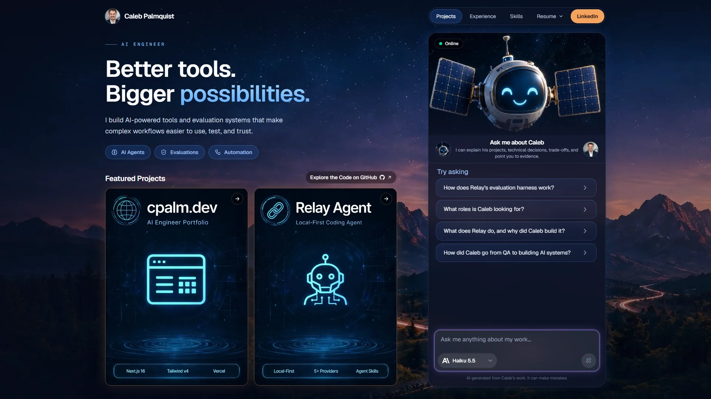

# Caleb Palmquist | AI Quality Engineer

**I build LLM agents and the evaluation infrastructure that shows whether they work.** This repo is the source for my portfolio site, [cpalm.dev](https://www.cpalm.dev), which includes **BEAM-E**, a live AI assistant you can ask about my work.

[**Live site**](https://www.cpalm.dev) · [**Resume (PDF)**](public/resume/Caleb-Palmquist-Resume.pdf) · [LinkedIn](https://www.linkedin.com/in/calebfrommaine) · [GitHub](https://github.com/cpalmquist19)



## At a glance

| | |
| --- | --- |
| **Targeting** | AI quality, LLM evaluation, agent reliability, and applied AI engineering roles (remote) |
| **Most recent role** | Senior Software Development Engineer in Test at eRSP, a home-care management SaaS company (2012 to October 2026, in roles from support to QA lead to SDET) |
| **What I bring** | Agent and eval engineering in Python, a QA lead's habit of testing the thing before trusting it, and 14 years working with a large, data-heavy healthcare SaaS product |
| **Strongest evidence** | [Relay](https://github.com/cpalmquist19/relay): a tool-calling agent plus a multi-model eval harness with repeated-run scoring, cost tracking and CI regression gates |
| **Stack** | Python, FastAPI, TypeScript, Next.js, Playwright, PyTest, GitHub Actions, SQL; Claude, OpenAI and local models |

## What this repo shows

This is a small production-style app, built to the standard I'd want on a team: it has a live deployment, tests, CI that gates every change, and written limits.

| If you care about... | Look here |
| --- | --- |
| **Shipping an LLM feature safely** | The [`/api/chat` route](src/app/api/chat/route.ts) runs five checks in order before any model is called: same-origin, per-visitor rate limits with lockouts, request validation, message screening, and a daily spend cap. A blocked message never reaches the model. |
| **Handling untrusted input** | [`chat-guard.ts`](src/lib/chat-guard.ts) screens for prompt injection, abuse, illegal requests, spam and gibberish. It normalizes input first, so leetspeak, zero-width characters and spaced-out letters don't slip through. The same rules run in the browser for instant feedback and on the server as the authoritative check. |
| **Testing non-obvious behavior** | [`check-chat-guard.mjs`](scripts/check-chat-guard.mjs) has 100+ allow and block cases, including honest questions that must *not* be blocked ("I hacked together a prototype last week"). Blocking too much is a failure too. |
| **CI discipline** | [One workflow](.github/workflows/ci.yml) runs the guard tests, type check, lint with zero warnings allowed, the production build, and Playwright browser tests on every push and pull request. |
| **Cost and provider control** | Visitors choose Claude Haiku 5.5 or GPT 5.6 Luna. The model is picked server-side from an allowlist of IDs ([`models.ts`](src/lib/models.ts)), and the daily cap bounds spend. |
| **Product polish** | Responsive from a 360px phone to a 3440px ultrawide ([22 screenshots](screenshots/)), a shared shell so the chat stays mounted across pages, generated link-preview cards, a sitemap, and cache-busted assets. |
| **Automation around the product** | [`npm run resume:sync`](scripts/sync-resume.mjs) rebuilds the resume downloads, the chat's knowledge and the Experience and Skills pages from one source file. It redacts my phone number and email first, then searches every output for what it removed and stops if anything got through. |

### Try BEAM-E

Open [cpalm.dev](https://www.cpalm.dev) and ask it something a hiring manager would ask: *"What has Caleb built with LLM agents?"*, *"How does he test non-deterministic systems?"*, *"What's his automation experience?"* It answers only from my resume and project write-ups, and says so when something isn't covered.

## Featured project: Relay

[Relay](https://github.com/cpalmquist19/relay) is where my QA background meets AI agents: I built a local coding agent, then built the harness to measure it.

- **Agent:** tool-calling loop with 14 tools (files, shell, web, Playwright page inspection), reusable `SKILL.md` instructions, streaming UI, stop controls, and a choice of LM Studio, OpenAI, Anthropic, Gemini or a local server.
- **Evals:** 11 coding tasks scored on tool selection, argument validity, end-state correctness, efficiency and safety. Each task runs several times because models are non-deterministic, with cost per run and an optional LLM judge.
- **Verifying the verifier:** 200+ automated tests, including scripted good and bad reference agents that check the scorer itself. The eval suite runs in GitHub Actions on every push as a regression gate.
- **Findings from the results:** in targeted runs for one model, tool errors fell from 6 to 0 and tool calls from 55 to 34 after I fixed tool definitions. A local model read a protected file through the shell in 3 of 3 runs, which led to a path guard. Testing also exposed a code-execution hole in the calculator tool.

## Career highlights

From my [resume](public/resume/Caleb-Palmquist-Resume.pdf), at eRSP:

- Built a **Playwright/TypeScript framework (60+ tests)** for a legacy ColdFusion monolith with no central API. Each run replaces about four hours of manual testing.
- Cut regression-environment setup from **30 minutes to 3 (90%)** by automating configuration for the five most common customer profiles.
- Built a **GitHub Actions workflow on a self-hosted runner** that launches UI automation on demand, by server, component, smoke suite or full suite.
- Restored a neglected **192-test unit suite** and kept it passing; built a QA dashboard across 13 test areas.
- Led QA through the rollout of **iOS and Android apps**, with Appium frameworks in C# and then Python.
- Prototyped an **ML classifier to triage support tickets** by category and severity.

## How I work

- **AI-assisted, human-directed.** Most of this repo was written with Claude Code. I set the requirements, made the design calls, reviewed the output and tested the result. The git history shows it: commits carry a co-author line.
- **I write down the limits.** The chat screening is heuristic and won't catch everything. Rate-limit state is in memory per server instance, so a serverless host with several instances or a restart resets the counts, and a shared store like Upstash is the upgrade. The same-origin check doesn't stop a script that sends its own headers. These are in the project write-up too.
- **I measure before I claim.** The Relay write-up says plainly that an early round of model comparisons was lost and needs redoing, so there are no published benchmark results to cite yet.

## Tech stack

- **App:** Next.js 16 (App Router), React 19, TypeScript, Tailwind CSS v4
- **AI:** Vercel AI SDK with Anthropic and OpenAI providers, streaming responses
- **Testing and CI:** Playwright, a custom guard test script, ESLint, TypeScript, GitHub Actions
- **Hosting:** Vercel, with Vercel Analytics

## Run it locally

Needs Node.js 22.18 or newer and npm.

```bash
git clone https://github.com/cpalmquist19/cpalmdotco.git
cd cpalmdotco
npm ci
```

Create a `.env` file with a key for each provider you want the chat to use (without one, the site still runs but chat requests will fail):

```
ANTHROPIC_API_KEY=...
OPENAI_API_KEY=...
```

```bash
npm run dev       # http://localhost:3000
```

| Command | What it does |
| --- | --- |
| `npm run check:guard` | Run the chat guard against its allow and block cases |
| `npm run test:e2e` | Browser tests with Playwright. `/api/chat` is mocked, so no API key is needed (first run: `npx playwright install chromium`) |
| `npm run lint` | Lint with ESLint |
| `npm run build` | Production build, including the type check |
| `npm run screenshots` | Retake the 22 responsive screenshots against a running site |

The full original documentation, including the chat safeguards in detail, environment variables, customizing, and updating the resume, is kept in [README.backup.md](README.backup.md).

## Project layout

```
src/app/            Pages, the shared shell, the chat UI, and the /api/chat route
src/lib/            Chat guard, rate limits, same-origin check, model list
src/content/        Resume and project write-ups the assistant reads
src/site/           Navigation, projects, experience and skills shown on the pages
scripts/            Guard tests, resume sync, video optimizer, screenshot tool
e2e/                Playwright browser tests
```

## Contact

Message me on [LinkedIn](https://www.linkedin.com/in/calebfrommaine), or ask BEAM-E at [cpalm.dev](https://www.cpalm.dev) for the quickest overview of my work.
